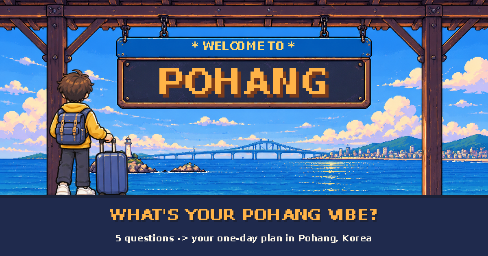

# What's Your Pohang Vibe?

**▶ Live site: https://pohangvibe.github.io/**

A retro pixel-art travel-style test that plans a one-day trip in Pohang, Korea for international visitors — starting and ending at Pohang Station, with real bus and driving times, rated local restaurants and useful Korean phrases.

## Why

A survey of 38 international respondents from 18 countries (November 2026) showed that the biggest difficulty in a new city is not transport, but **knowing which places are actually worth the trip** — picked by 63% of potential visitors and 73% of people living in Pohang. Interest-based itineraries were the most wanted feature (47%).

This site answers that with a short test and a ready-to-follow day plan.

## How it works

1. **4 taste questions** — interest (ocean / food / culture / nature), travel style, what makes a trip memorable, food preference
2. **1 condition question** — bus, car, taxi or not sure yet
3. **Result** — a travel type, a timed one-day route, place cards (how to get there, hours, cost, a Korean phrase, map links) and a shareable image card

## Data

| Data | Source |
|---|---|
| Places: hours, closing days, fees, location | Korea Tourism Organization TourAPI |
| Restaurant & café candidates | Kakao Local API |
| Ratings, review counts, opening hours, break times | Kakao Map place pages |
| Driving time & taxi fare | Kakao Mobility Directions API |
| Bus routes, time & fare | ODsay Public Transit API |

Restaurants are included only with **30+ reviews and a 3.5+ rating** on Kakao Map.

## Route generation & validation

- Every ordering of 2–5 places (out of 21) is simulated as a real day from Pohang Station at 09:00.
- A route must pass all checks: back at the station by 21:30, lunch 11:30–13:30 and dinner 17:30–19:30, inside opening hours and restaurant break times, total travel ≤ 250 min by bus / 180 min by car, and no mixing of the far south and far north of the city in one day.
- For each of the **768 answer combinations** (256 taste answers × 3 transport modes), the best-scoring valid route is chosen.
- A separate checker re-validates all 768 results — **0 issues**.
- Result: **204 distinct routes** (138 distinct sets of places).

## Feedback

Each result page asks for a 1–5 satisfaction rating and an optional one-line comment, collected anonymously.

---

Place details checked November 2026. Opening hours can change — please check before you go.
